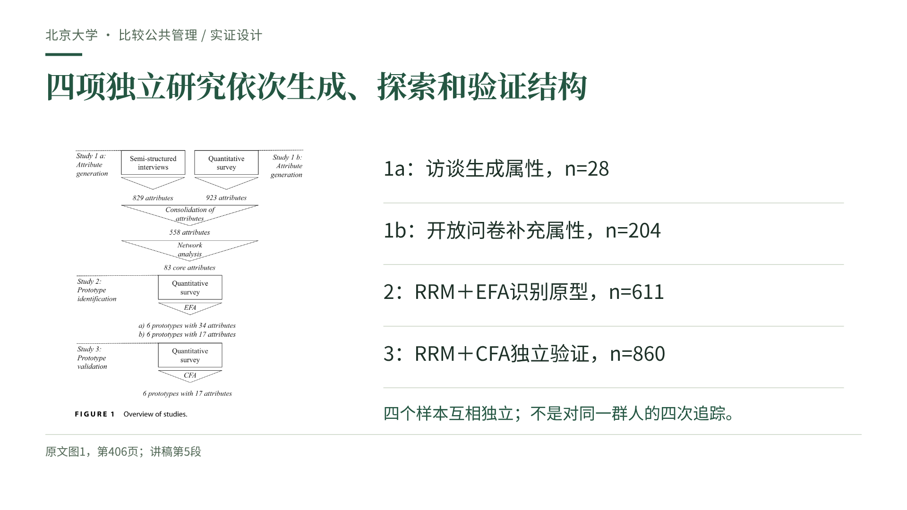
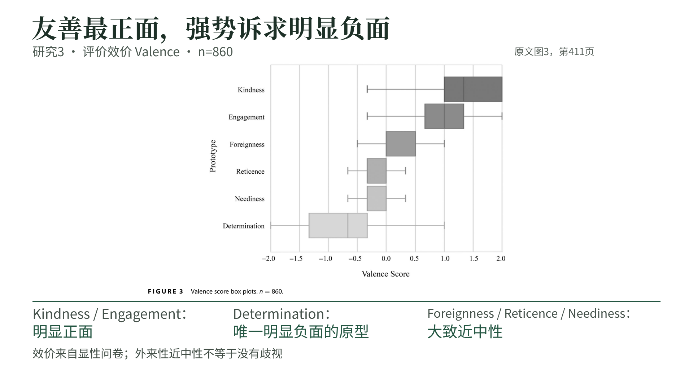

# 内隐公民理论｜30分钟课堂汇报成品

**AB混搭：人文学术绿的配色与衬线标题，结合白底原文大图和证据优先版式。**

- [下载成品 PowerPoint（PPTX）](presentation-AB.pptx?raw=true)
- [在线验收全部29页 PDF](presentation-AB.pdf)
- [下载整包：PPT、PDF、逐页讲稿及HTML演示版](presentation-AB-delivery.zip?raw=true)
- [阅读逐页讲稿与建议时间](speaker-notes.md)

## 使用说明

24页正式讲述，计划30分钟；第25–29页是参考文献、原始数据和答疑备份，问答另计。封面汇报人留空，自填即可，不使用北京大学校徽或学校模板。

完整讲稿按原顺序写入PowerPoint的演讲者备注，可在“备注”或“演讲者视图”查看。文字与版式可编辑；原文图表保留为高清图片，未重画或改变数值。建议先按自己的语速排练；30分钟包含解释图表和适当停顿。

排版使用思源宋体（Noto Serif CJK SC）与思源黑体（Noto Sans CJK SC）。如电脑未装这两种字体，PPT可能发生字体替代；需要固定版面时可用随附PDF投影。

整包解压后可打开index.html查看HTML概览墙和逐页演示。GitHub本身用于查看PDF和下载文件，不直接运行HTML。

## 内容与核查

内容顺序遵照已有30分钟讲稿：研究问题→概念与机制→四项研究→六个原型→验证及效价→贡献与局限→比较公共管理拓展→后续研究与实践启示。原文结果和自主拓展明确区分。

三张原文图、两张原表及附录B均来自用户提供的论文。六个原型是可同时存在的认知维度；德国单国研究没有证明真实服务待遇的因果后果。完整出处与原文页码保留在页内或备注中。

[逐节点Skill核查记录](skill-checklist.md) · [导出验收记录](final-verification.json)

## 预览

## 文献来源

Vogel, R., Vogel, D., Liegat, M. C., & Hensel, D. (2025). From Social Categorization to Implicit Citizenship Theories: Advancing the Socio-Cognitive Foundations of State–Citizen Interactions. *Public Administration Review*, 85(2), 402–418. https://doi.org/10.1111/puar.13844

依据开放获取原文制作，保留作者、年份、页码和图表标题。原文采用署名—非商业许可，本材料供非商业课程学习。
