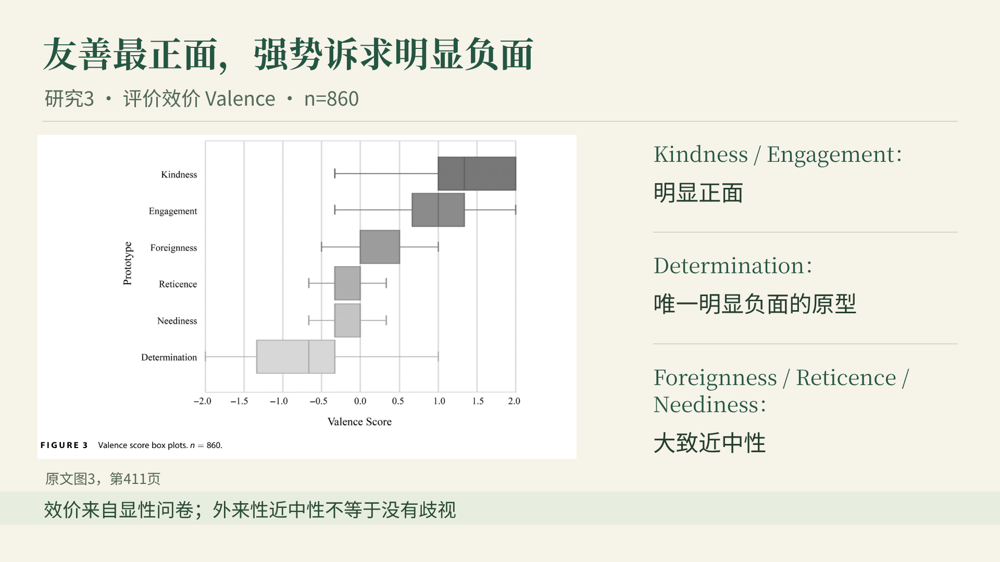
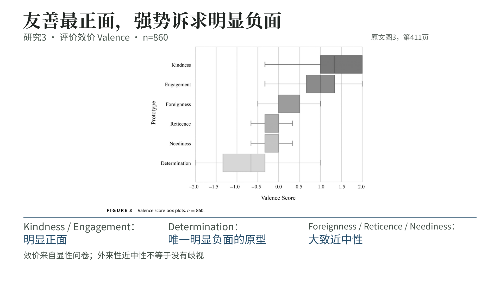
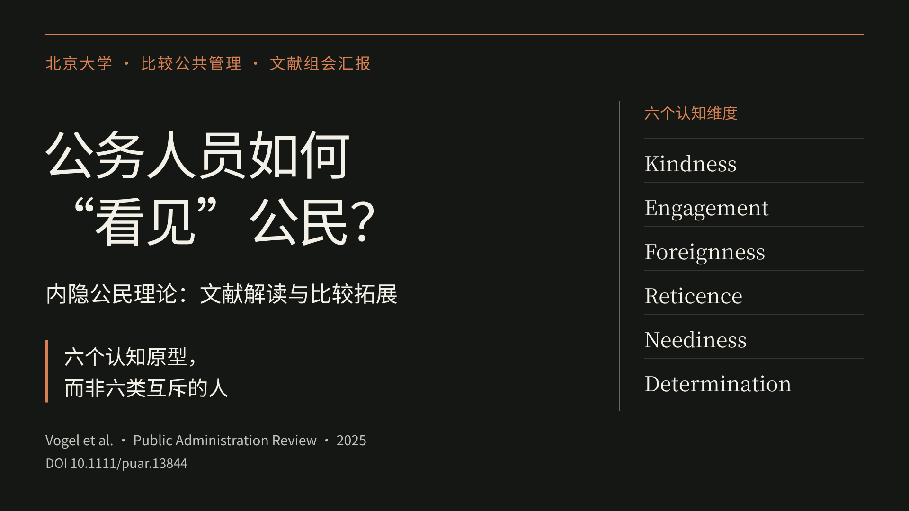
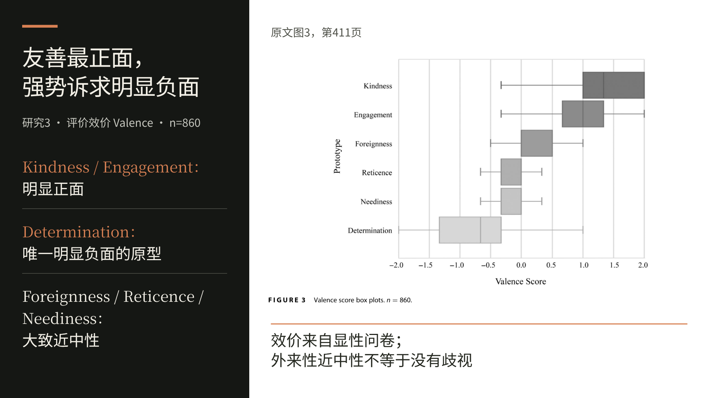

# PPT大纲与三套真实风格初稿

当前阶段：大纲及风格样页已完成，完整PPT待选择风格后制作。讲述约30分钟，问答另计；北京大学比较公共管理课程；姓名留空自填，不使用校方模板。

## 先查看大纲

- [逐页大纲（网页阅读，含原文图片）](ppt-outline.md)
- [逐页大纲 PDF](ppt-outline.pdf)
- [大纲 Word 下载](ppt-outline.docx?raw=true)

大纲包含24页主体和4页备份（两张原始数据表可按可读性拆成两备份页），每页注明显示文案、图表方案、原文依据、内容性质及讲述时间。主体累计30分钟；7090汉字原讲稿完整按顺序映射为未来PPT备注，未为压缩页面而删掉讲述内容。

## 选择风格：请看真实样页

[六页风格对比 PDF：前两页A，中两页B，后两页C](style-candidates.pdf)

[六页可编辑PPTX样稿下载（仅风格初稿，非完整成品）](style-candidates.pptx?raw=true)

|方案|实际样稿|视觉特点|联网参照|
|---|---|---|---|
|A 人文学术绿|[两页PDF](style-A-preview.pdf)|暖象牙、森林绿、衬线大标题，温和的人文学术气质|[Focus](https://github.com/pcafrica/focus-beamertheme)的内容优先与主色可定制原则；本项目自主布局|
|B 证据优先白|[两页PDF](style-B-preview.pdf)|白底、克制深蓝、大图和结论标题，明亮投影下清晰|[Quarto clean](https://github.com/grantmcdermott/quarto-revealjs-clean)，学术极简主题|
|C 理论图谱黑|[两页PDF](style-C-preview.pdf)|暖黑与橙色、大排印、白底证据区，对比鲜明|[Metropolis](https://github.com/matze/mtheme)，现代Beamer学术主题|

三套都以相同封面与相同原文图3作对比。它们是依据真实学术主题原则所做的本项目初稿，不是官方模板的原样复制。可选择A/B/C，也可指定“某版配色＋另一版布局”。

### A｜人文学术绿

### B｜证据优先白

### C｜理论图谱黑

## 已知信息与下一步

- 已确认：中文主文案、英文术语、16:9；姓名自填；讲述30分钟，问答另计。
- 交付目标：北京时间2026年10月13日08:00前完成；现在准备，选定风格后生成可编辑PPTX、PDF及HTML演示版。
- 当前会话没有内置长期定时工具，没有设置关闭会话后自动唤醒或发送的任务。
- 风格须由用户选定：[huashu-design的SKILL.md](https://github.com/alchaincyf/huashu-design/blob/0830494ecb1c117e25b313a8114fe55a6bf2b125/SKILL.md)要求“展示后必须停……等用户选择”。因此此阶段不会自行选风格制作全部页面。
- 图片均来自上传文献真实图表；六原型为认知维度，不是六类互斥现实公民；理论、实证与自主拓展分开标注。

## 原文与素材

Vogel, R., Vogel, D., Liegat, M. C., & Hensel, D. (2025). From Social Categorization to Implicit Citizenship Theories: Advancing the Socio-Cognitive Foundations of State–Citizen Interactions. *Public Administration Review*, 85(2), 402–418. https://doi.org/10.1111/puar.13844

[原文图表核验清单](assets-audit.md) · [联网模板参照说明](template-references.md)

依据开放获取原文制作，仅供非商业课程学习，保留作者、年份、来源及图表页码。
