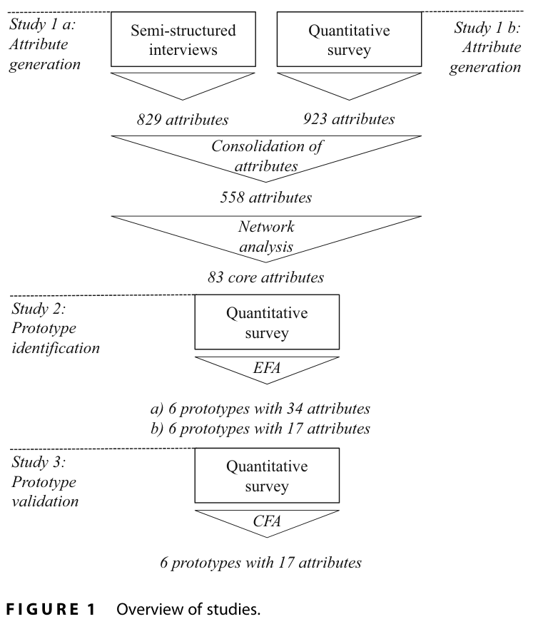
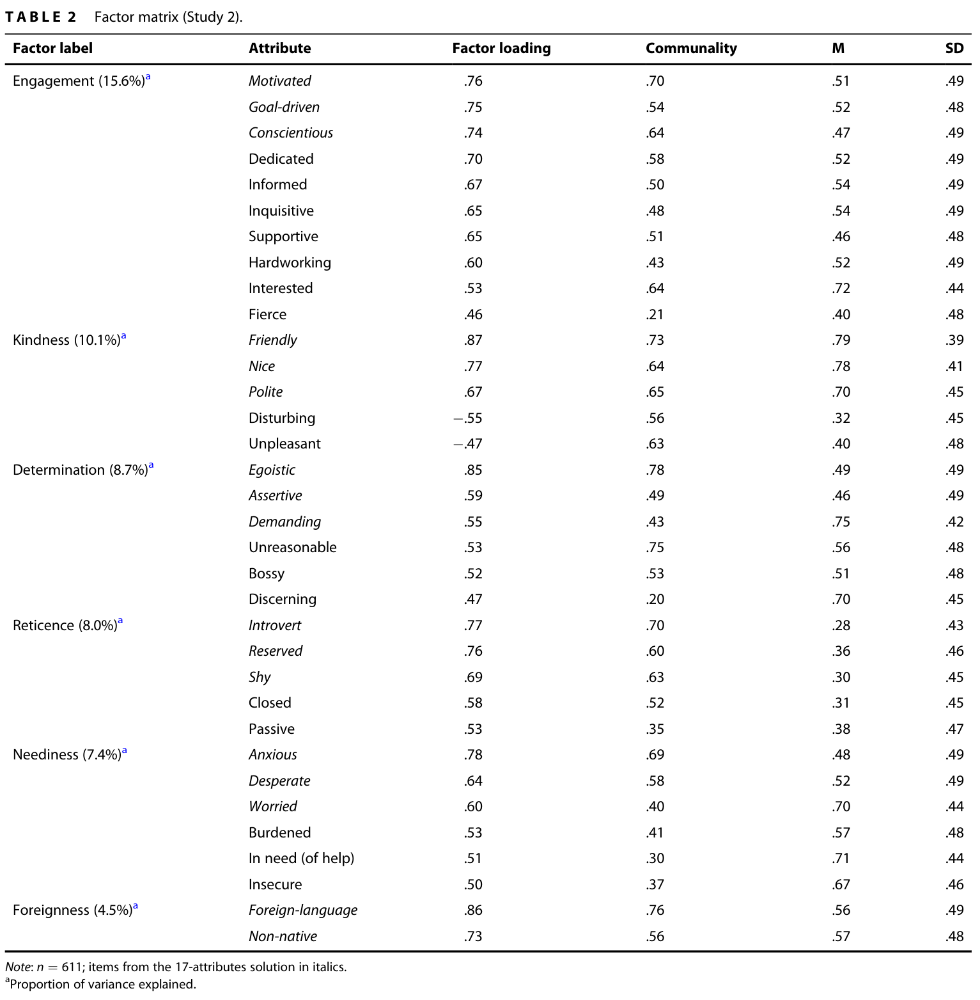
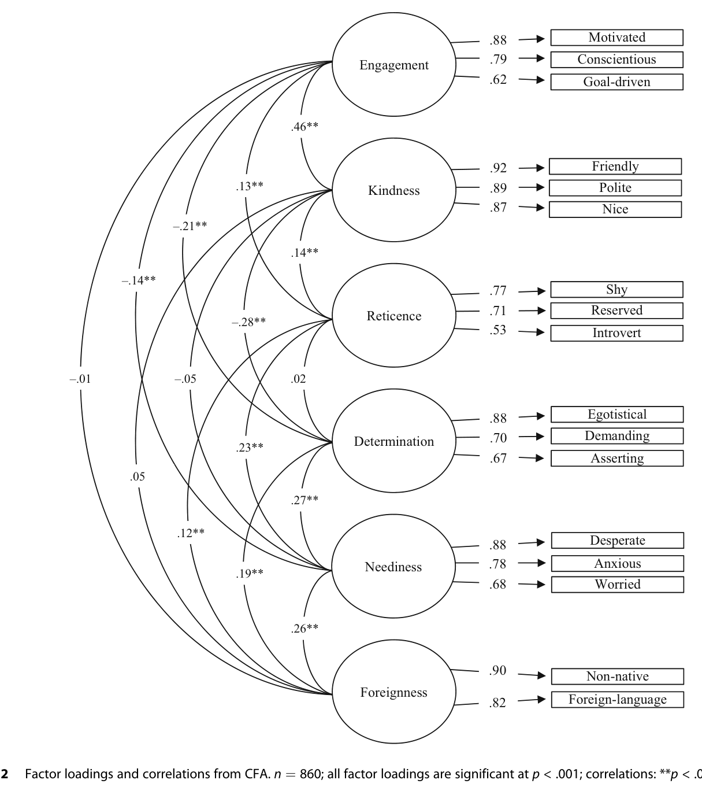
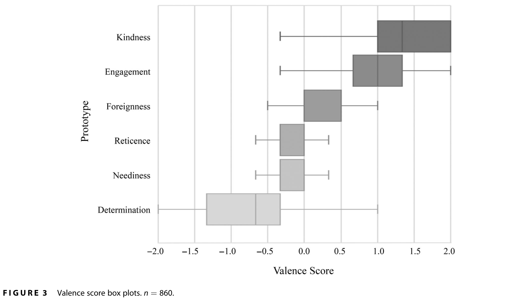
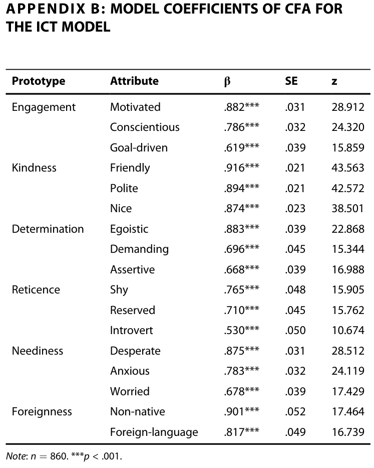
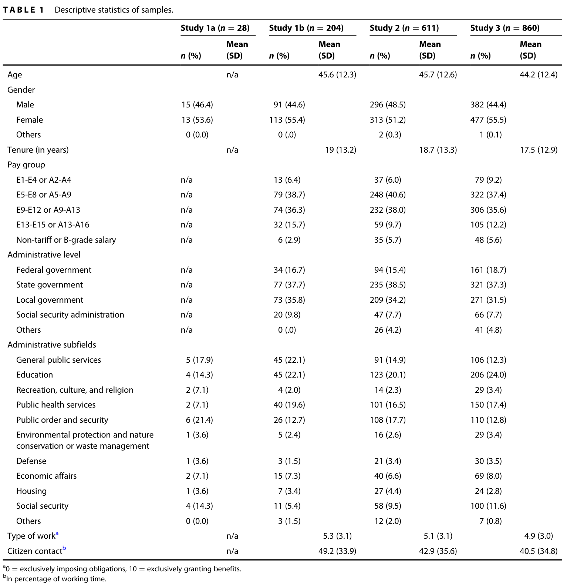

# PPT逐页大纲与文案（供风格选择前审阅）

## 确认的要求

- 北京大学比较公共管理课程；不用学校模板，姓名留空自填。
- 16:9，中文为主，保留原文专业术语；可编辑PPTX＋PDF。
- 24页主体、约30分钟；4页备份，问答另计。
- 截止：北京时间2026年10月13日08:00。
- 先完整大纲，再三套真实风格初稿；用户选定后批量生成成品。
- 图表优先原文，数据不伪造；中国与跨国拓展明确标为自主拓展。
- 当前未设置自动定时执行：会话无内置长期调度工具。

## 大纲说明

每页包含标题、直接显示文案、图片方案、原文依据、讲稿对应及时间。正文讲稿已按原顺序完整映射到JSON的speaker_notes中，7090个汉字未被删减；演示页只显示精炼文案。备份27可因两张原表可读性拆为两页，不改变主体时长。

## 时间安排

### 01｜公务人员如何“看见”公民？

时间：00:00–00:25；内容性质：文献定位。

**屏幕文案**

- 内隐公民理论：文献解读与比较公共管理拓展
- 北京大学 · 比较公共管理
- Vogel et al.｜Public Administration Review｜2025
- 汇报人：________

**图片与布局方案**

以题目与论文身份建立主线；姓名留空，无学校logo。

**原文依据**

原文第402页；文献DOI 10.1111/puar.13844

### 02｜相同资格，为什么可能得到不同解释？

时间：00:25–01:30；内容性质：课堂解释。

**屏幕文案**

- 假设场景：两位公民申请同一服务，材料与资格一致
- 一位客气且准备充分；另一位焦虑、反复追问并坚持获得解释
- 关键问题：工作人员回应的是条件，还是心中的标签？

**图片与布局方案**

两个等资格文本栏，中间提出认知问题；不放虚构实证数字或人物照片。

**原文依据**

讲稿第1段；自拟解释场景，不是论文案例

### 03｜已有研究观察“信号—回应”，本文打开认知黑箱

时间：01:30–03:30；内容性质：研究问题。

**屏幕文案**

- 已有线索：性别、族群、阶层、动机与deservingness
- 研究缺口：工作人员带入工作的广泛公民认知结构
- 本文关注：同一线索如何被不同解释框架理解

**图片与布局方案**

对比“信号→回应”与加入认知过滤的链条；图形明确为理论示意。

**原文依据**

原文第403–404页；讲稿第2段

### 04｜ICTs把属性、原型与日常理论组织起来

时间：03:30–04:45；内容性质：理论概念。

**屏幕文案**

- 属性：礼貌、焦虑、有动力等词语
- 原型：语义相关属性组成的认知形象
- ICTs：多个相关原型构成的日常解释框架
- Implicit Citizenship Theories ≠ 信息通信技术

**图片与布局方案**

三层结构示意，用词语与排印体现层级，不伪装为统计网络。

**原文依据**

原文第404–405页；讲稿第3段

### 05｜“内隐”不等于完全无意识，“公民”也不限于国籍

时间：04:45–05:30；内容性质：理论概念。

**屏幕文案**

- 内隐认知：常以快速、联想式加工起作用，但可部分反思
- Typical：通常是什么样；Ideal：最好是什么样
- 二者在本文测量中未被完全分开
- Citizen：工作人员日常理解的服务对象，也可能包括游客或移民

**图片与布局方案**

两组概念并置：加工方式、角色边界；每组不超过两段短句。

**原文依据**

原文第404–405页；讲稿第3段

### 06｜认知原型可能连接线索与回应，但行为链条尚待检验

时间：05:30–07:30；内容性质：理论机制及证据边界。

**屏幕文案**

- 既往经验与社会化 → 公民认知图式
- 互动线索 → 激活原型 → 与目标人物匹配
- 可能影响解释、态度与行为
- 本文直接检验认知结构，未检验链条中的全部因果环节

**图片与布局方案**

理论链条＋证据范围框；将“可能”写入箭头说明，不能画成已验证因果模型。

**原文依据**

原文第405–406页；讲稿第4段

### 07｜四项独立研究依次生成、探索和验证结构

时间：07:30–08:40；内容性质：实证设计。

**屏幕文案**

- 1a：访谈生成属性，n=28
- 1b：开放问卷补充属性，n=204
- 2：RRM＋EFA识别原型，n=611
- 3：RRM＋CFA独立验证，n=860

**图片与布局方案**

原文图1为主图；右侧用中文写出四步及独立样本提醒。

**原文依据**

原文图1，第406页；讲稿第5段

### 08｜从558个不重复属性筛选为83个测量条目

时间：08:40–09:40；内容性质：实证设计。

**屏幕文案**

- 访谈：829次提及 → 389个不同属性
- 开放问卷：923次提及 → 291个不同属性
- 合并去重：558个属性
- 联想网络核心85个，删除2个歧义词 → 83个

**图片与布局方案**

保留原文图1局部并配数字流水；区分“提及次数”与“属性种类”。

**原文依据**

原文第406–408页、图1；讲稿第5段

### 09｜跨领域覆盖增强广度，但样本仍全部来自德国

时间：09:40–10:30；内容性质：样本及适用范围。

**屏幕文案**

- 覆盖多个公共服务领域及联邦、州、地方层级
- 四项有效样本合计1703，不能合并成一份完整测量样本
- 德国：大陆法治传统、联邦制与公共部门专业化
- 跨岗位结构验证，不等于跨国可推广性

**图片与布局方案**

四个样本量与行政情境短句；表1完整原图移至备份，不把全表缩成不可读小字。

**原文依据**

原文表1，第407页；情境说明第406页；讲稿第5段

### 10｜RRM用限时匹配判断减少反思性作答

时间：10:30–11:40；内容性质：测量方法。

**屏幕文案**

- 随机呈现“公民”与83个属性词
- 快速选择 Match / No match
- 保留300–10,000ms反应；研究2有效回答平均约1.38秒
- 限时测量接近联想，但不保证捕捉全部无意识偏见

**图片与布局方案**

屏幕任务简图，标“根据程序说明绘制”；不伪造参与者真实截图或结果。

**原文依据**

原文第408页；讲稿第6段

### 11｜EFA得到六因子，并形成34项与17项两个版本

时间：11:40–13:00；内容性质：实证方法与结果。

**屏幕文案**

- 数据：二元回答；四分相关矩阵；允许因子相关
- 六因子34属性：解释54.4%方差；五因子50.9%
- 每因子保留三个高载荷属性，Foreignness保留两个
- 因子分析识别属性维度，不是把人聚成六群

**图片与布局方案**

原文表2截取因子名称与代表属性；中文流程说明34→17。完整表进入备份。

**原文依据**

原文表2，第409页；方法第408页；讲稿第6段

### 12｜六个原型是六副认知镜头，可以同时出现

时间：13:00–13:35；内容性质：实证结构及概念解释。

**屏幕文案**

- Engagement｜参与投入；Kindness｜友善
- Determination｜强势诉求；Reticence｜内敛
- Neediness｜求助困境；Foreignness｜外来性
- 同一公民可能同时触发多个原型

**图片与布局方案**

六名称轨道或2×3列表；不用真实人口分类图、饼图或类型占比。

**原文依据**

原文第409–412页、附录B；讲稿第7段

### 13｜参与投入关注行动投入，友善关注互动方式

时间：13:35–14:35；内容性质：原型解释。

**屏幕文案**

- Engagement：motivated / conscientious / goal-driven
- 中文：有动力、认真尽责、目标导向
- Kindness：friendly / polite / nice
- 中文：友好、有礼貌、和善

**图片与布局方案**

双栏中文属性，保留英文词；加入一句“客气不等于准备充分”。

**原文依据**

原文附录B，第418页；讨论第411–412页；讲稿第7段

### 14｜强势诉求不能自动等同无理，内敛也不等同不合作

时间：14:35–15:35；内容性质：原型解释＋自主评议。

**屏幕文案**

- Determination：egoistic / demanding / assertive
- 语境译法：自我中心、要求很多、坚持己见
- Reticence：shy / reserved / introvert
- 规范性追问：合法权利表达与攻击行为应区分

**图片与布局方案**

双栏词组，底部明确“规范性追问”为汇报评议；不把全部维权者贴负面标签。

**原文依据**

原文附录B、第412页；规范性追问为讲稿拓展

### 15｜求助困境与外来性不能替代资格和歧视测量

时间：15:35–16:30；内容性质：原型解释及边界。

**屏幕文案**

- Neediness：desperate / anxious / worried，主要表现情绪困境
- 不等于已核实贫困程度或法定救助资格
- Foreignness：non-native / foreign-language
- 来源与语言联想，不是对某群体的全面态度

**图片与布局方案**

双栏关键词；示例“礼貌而焦虑的人可同时对应多个原型”。

**原文依据**

原文附录B、第412页；讲稿第7段

### 16｜独立CFA更支持17属性的一阶六因子模型

时间：16:30–17:30；内容性质：实证验证。

**屏幕文案**

- 研究3：n=860，稳健DWLS估计
- 34项→17项：CFI .866→.960；RMSEA .082→.049
- 17项：TLI .948；SRMR .067
- 拟合良好支持结构，不等于证明行为预测与因果

**图片与布局方案**

原文图2保留完整载荷图；旁边只呈现核心拟合指标，双向线标“相关”。

**原文依据**

原文图2，第410页；指标第409页；讲稿第8段

### 17｜友善最正面，强势诉求明显负面

时间：17:30–18:30；内容性质：实证结果及边界。

**屏幕文案**

- Kindness / Engagement：明显正面
- Determination：唯一明显负面的原型
- Foreignness / Reticence / Neediness：大致近中性
- 效价来自显性问卷；外来性近中性不等于没有歧视

**图片与布局方案**

原文图3大图，不估读精确均值；保留0刻度与全部箱须及英文标签。

**原文依据**

原文图3，第411页；讨论第412页；讲稿第8段

### 18｜测量结构相近，不意味着个体评价与水平相同

时间：18:30–20:00；内容性质：事后分析。

**屏幕文案**

- 测量不变性：给予福利/施加义务；公民接触程度
- 作者未发现达到统计显著程度的测量差异
- 性别、薪酬组与部分原型显著性/效价有关联
- 结构可比 ≠ 平均水平相同；回归关联 ≠ 因果

**图片与布局方案**

上下分区：结构检验与个体关联，避免将回归关系画成因果箭头。

**原文依据**

原文第410–411页；补充材料H/I未随PDF提供；讲稿第9段

### 19｜贡献是建立认知框架，行为后果仍待验证

时间：20:00–22:00；内容性质：学术贡献＋自主评议。

**屏幕文案**

- 理论：把具体信号研究推进为一般认知结构研究
- 内容：纳入互动风格、情绪与来源维度
- 方法：自由生成＋网络筛选＋限时测量＋独立验证
- 没有随机改变ICTs并观察真实差别待遇；干预建议非本研究实验结果

**图片与布局方案**

左侧三贡献，右侧证据边界；标题是结论而不是“研究意义”泛词。

**原文依据**

原文讨论第411–414页；讲稿第10段

### 20｜常见性、测量便捷性与规范重要性并不相同

时间：22:00–24:00；内容性质：批判性评议。

**屏幕文案**

- 网络核心筛选可能遗漏少见但严重的排斥联想
- 二元判断、典型/理想混合、两指标外来性限制覆盖
- 均值填补需检查稳健性，作者已有无调整对照
- 工作人员觉得可取，不代表可以据此优待公民

**图片与布局方案**

三个问题分别展示“内容覆盖/测量意义/公平规范”；不把评论写成作者发现。

**原文依据**

原文局限第413–414页；讲稿第11段自主评议

### 21｜跨国比较要先比较概念，再比较分数

时间：24:00–26:00；内容性质：比较公共管理拓展。

**屏幕文案**

- 行政传统与组织环境可能影响认知及互动
- 中国拓展线索：数字服务困难、人口流动与规则熟悉程度
- foreign-language ≠ 方言；non-native ≠ 外地户籍
- 先自由生成属性，再检验结构、载荷与阈值等值

**图片与布局方案**

从概念到测量到比较的三步图；不画中德高低排名或未经证实的国家差异。

**原文依据**

原文第406、413–414页；讲稿第12段自主拓展；Jilke et al. 2015

### 22｜下一步应检验合法表达风格如何影响帮助意愿

时间：26:00–28:00；内容性质：自主研究设想。

**屏幕文案**

- 相同资格、材料、礼貌程度；随机改变诉求坚定程度
- 测量：额外解释时间、操作提示、对行为的解释
- 测量ICTs本身不等于随机操纵ICTs
- 可加入随机程序权利提醒；学生模拟不能代替真实工作人员证据

**图片与布局方案**

实验条件与结果变量示意；醒目标“研究设想，未实施”。

**原文依据**

讲稿第13段自主研究设计；依据本文理论框架

### 23｜公平需要认知干预，也需要流程与组织保障

时间：28:00–29:30；内容性质：实践启示及自主拓展。

**屏幕文案**

- 作者建议：反原型信息、降低认知负荷、重复互动规范
- 公共服务生态系统：理解公民的整体处境与共同创造角色
- 自主拓展：清晰说明、数字协助、申诉与复核
- 即使不喜欢表达方式，也应依规则处理合法请求

**图片与布局方案**

分清“作者建议/本汇报拓展”，底部公平原则；不宣称本研究证明干预有效。

**原文依据**

原文第413页；讲稿第14段

### 24｜认知结构被看见之后，公平机制才更容易被研究

时间：29:30–30:00；内容性质：汇报总结。

**屏幕文案**

- 六个认知原型，不是六类互斥的公民
- 结构得到验证，真实服务因果后果尚待检验
- 比较研究：制度与组织如何影响认知，认知何时进入行为
- 谢谢｜讨论

**图片与布局方案**

三个短结论，明确收束，无煽动性口号。

**原文依据**

讲稿第15段；原文结语第414页

### 25｜备份｜关键参考文献

时间：备份，不计入30分钟；内容性质：参考文献。

**屏幕文案**

- Vogel et al. 2025，本文，DOI 10.1111/puar.13844
- Lipsky 2010，Street-Level Bureaucracy
- Jilke & Tummers 2018，deservingness，DOI 10.1093/jopart/muy002
- Jilke et al. 2015，测量等价，DOI 10.1111/puar.12318
- Osborne et al. 2022，服务生态系统，DOI 10.1111/puar.13474
- Kuhlmann & Wollmann 2019，比较公共行政导论

**图片与布局方案**

文字参考列表，不能小字堆满80篇；完整列表在译稿。

**原文依据**

原文参考文献第414–416页

### 26｜备份｜17个最终指标与CFA精确系数

时间：备份，不计入30分钟；内容性质：备份数据。

**屏幕文案**

- n=860；全部载荷p<.001
- β为标准化载荷，SE为标准误，z为检验统计量
- 六因子相互相关，模型不是公民好坏单一总分

**图片与布局方案**

附录B完整表格大图，配中文简短读图说明。

**原文依据**

原文附录B，第418页

### 27｜备份｜样本与EFA原表

时间：备份，不计入30分钟；内容性质：备份数据。

**屏幕文案**

- 表1：四项独立研究样本情况
- 表2：34属性六因子载荷；短版保留17属性
- 研究1a性别人数和百分比原表不一致，照录但不用于推论

**图片与布局方案**

此页可只显示两表缩略入口；PDF/PPT需可读时拆为两备份页，不强行缩字。

**原文依据**

原文表1第407页、表2第409页

### 28｜备份｜容易被问到的证据边界

时间：备份，不计入30分钟；内容性质：问答。

**屏幕文案**

- 六原型≠六类人；RRM≠IAT
- 外来性中性≠没有歧视
- 测量不变性≠组间水平相同
- 德国单国研究≠已经完成中德比较
- 1703为四项样本总和，CFA样本只有860

**图片与布局方案**

并列问答短句，适合问答时定位；详细答复见讲稿备答。

**原文依据**

讲稿备答；原文方法与局限

## 交付格式与检查要求

1. PPTX文字可编辑，原文图表作为高分辨率图片保留。
2. PDF每页与PPTX对应，检查中文、图表、引用与无溢出。
3. 主体顺序严格遵照15段讲稿，不以风格重新排列研究逻辑。
4. 三方向共用封面和第17页数据内容，比较设计而非内容。
5. 成品与草稿统一上传到已授权GitHub仓库，提供网页阅读与下载入口。